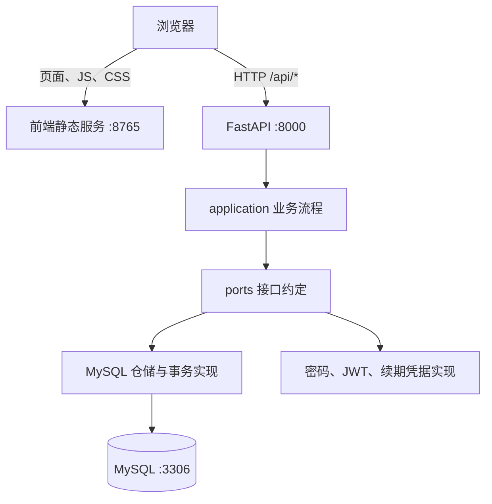

# 行序 · 数据处理平台

一个开发中的 Python 后端项目，目标是让业务人员上传订单 CSV 文件，由后台异步完成数据校验、统计和报告生成，减少手工逐行检查和批量处理时的等待。

**当前阶段：后端基础设施和账号认证已实现，注册、登录、自动续期与退出已接入前端。已增加登录后临时接收单个文件的接口；文件持久化、后台处理和报告功能尚未实现，工作台中的任务和文件是静态示例。**

导航：[业务流程](#业务流程) · [当前进度](#当前进度) · [快速开始](#快速开始) · [项目架构](#项目架构) · [配置](#配置) · [接口概览](#接口概览) · [测试](#测试) · [开发路线](#开发路线)

## 业务流程

下面是项目的目标流程，账号之后的数据处理环节仍在开发计划中：

```text
用户注册、登录
    ↓
上传订单 CSV 文件
    ↓
保存文件信息、所属用户并创建处理任务
    ↓
任务排队，由后台 Worker 分批读取和校验
    ↓
持续更新任务状态和进度
    ↓
查看有效行、错误行、问题明细和统计结果
    ↓
下载报告或错误数据，修正后重新提交
```

拟定校验内容包括必填字段、订单号重复、金额与日期格式等，具体规则将在处理模块中确定。**文件中有问题数据是正常的校验结果；程序执行异常才进入任务失败、重试或恢复流程。**

用户隔离将贯穿文件、任务和报告：后端根据认证身份检查数据归属，不能仅依赖前端隐藏其他用户的数据。当前已具备身份识别能力，真实业务数据的归属过滤尚未接入。

## 当前进度

| 模块 | 状态 | 当前范围 |
| --- | --- | --- |
| 应用基础 | 已实现 | FastAPI 入口、健康检查、配置、跨域、请求日志、统一异常响应 |
| 数据库基础 | 已实现 | MySQL 连接池、独立 Session、事务提交/回滚、Alembic 迁移 |
| 用户账号 | 已实现 | 注册、账号规范化与唯一性约束、Argon2id 密码哈希及验证 |
| 登录与会话 | 已实现 | JWT、当前用户查询、续期凭据轮换、会话到期与退出撤销 |
| 前端账号流程 | 已实现 | 真实注册/登录、自动续期、错误提示、网络失败恢复、退出 |
| 工作台页面 | 静态原型 | 任务、文件、规则展示，筛选、详情和文件选择表单 |
| 文件上传与存储 | 接口骨架 | 登录后临时接收单个非零字节 .csv 文件，扩展名不区分大小写，大小上限默认 50 MiB；内容检查、正式存储、文件与任务记录待实现 |
| 异步数据处理 | 待实现 | 队列、Worker、批量读取、校验统计、进度更新 |
| 结果和报告 | 待实现 | 错误明细持久化、报告生成与下载 |
| 可靠性与业务隔离 | 待完善 | 任务幂等、失败恢复、文件/任务归属检查、性能测试和部署 |

后台队列和 Worker 尚未接入，因此 Redis、Celery 等不属于当前已安装运行的组件。技术选型将在实现异步处理时确定。

## 快速开始

以下命令使用 **Windows PowerShell**，在项目根目录（`requirements.txt` 所在目录）执行。已验证的本地环境为 Windows、Python 3.12.10 和 MySQL 8.0；后端依赖版本以 [requirements.txt](requirements.txt) 为准。

### 首次安装

**1. 获取代码、创建虚拟环境并安装依赖**

已有本地仓库时跳过克隆和进入目录的两行。请先确认 `python --version` 对应 Python 3.12。

```powershell
git clone https://github.com/wjczsg/data-processing-platform.git
cd data-processing-platform
python -m venv .venv
.\.venv\Scripts\python.exe -m pip install -r requirements.txt
```

后续命令直接使用项目的 Python，无需手动激活虚拟环境。运行网页不需要 Node.js 或前端打包；Node.js 仅用于运行前端自动化测试。

**2. 启动本机 MySQL 并创建数据库**

在 Navicat 查询窗口或 MySQL 命令行中执行：

```sql
CREATE DATABASE IF NOT EXISTS data_processing_platform
  CHARACTER SET utf8mb4
  COLLATE utf8mb4_0900_ai_ci;
```

数据库的账号和密码使用自己本机的配置，仓库没有内置默认登录账号。

**3. 准备本机配置**

仅在 `.env` 不存在时复制模板，避免覆盖已有凭据：

```powershell
if (-not (Test-Path -LiteralPath .env)) {
    Copy-Item -LiteralPath .env.example -Destination .env
}
```

生成独立的随机 JWT 密钥，将输出填入 `.env` 的 `JWT_SECRET_KEY`：

```powershell
.\.venv\Scripts\python.exe -c "import secrets; print(secrets.token_urlsafe(48))"
```

至少填写 `.env` 中的以下内容，示例文字需要替换为自己的值：

```dotenv
MYSQL_HOST=127.0.0.1
MYSQL_PORT=3306
MYSQL_DATABASE=data_processing_platform
MYSQL_USER="填写本机 MySQL 账号"
MYSQL_PASSWORD="填写本机 MySQL 密码"
JWT_SECRET_KEY="填写刚生成的随机密钥"
```

其余配置可先使用模板默认值。`.env` 已被 Git 忽略，提交配置示例使用 `.env.example`，不要把本机凭据替换进模板。已有有效密钥时继续使用，避免重新生成造成旧访问令牌失效。

**4. 应用数据库迁移**

```powershell
.\.venv\Scripts\python.exe -m alembic upgrade head
```

当前迁移版本为 `0002`：`0001` 创建用户表，`0002` 新增登录会话和续期凭据记录。迁移不会自动插入演示账号；首次使用请在页面注册。

### 日常启动：一条命令启动前后端

数据库服务运行、配置和迁移准备好后执行：

```powershell
.\.venv\Scripts\python.exe dev.py
```

| 地址 | 用途 |
| --- | --- |
| [http://127.0.0.1:8765/auth.html](http://127.0.0.1:8765/auth.html) | 注册、登录 |
| [http://127.0.0.1:8765/](http://127.0.0.1:8765/) | 工作台，普通入口先验证登录身份 |
| [http://127.0.0.1:8765/index.html?preview=1](http://127.0.0.1:8765/index.html?preview=1) | 不登录预览静态示例，不绕过后端接口认证 |
| [http://127.0.0.1:8000/docs](http://127.0.0.1:8000/docs) | Swagger 接口文档与调试 |
| [http://127.0.0.1:8000/api/health](http://127.0.0.1:8000/api/health) | 接口服务存活检查，不检查 MySQL |

`dev.py` 在同一终端启动前端静态服务 `8765` 和后端 `8000`。按一次 **Ctrl+C** 同时停止；修改后端 Python 代码会自动重载，修改前端后刷新页面即可。

更新代码后先应用新增迁移；修改 `.env` 后需重启后端。本次会话升级后旧 JWT 不带会话编号，需要重新登录一次。旧页面可按 **Ctrl+F5** 强制刷新。

### 可选：分别启动

在两个终端分别运行：

```powershell
# 后端
.\.venv\Scripts\python.exe -m uvicorn backend.app.main:app --reload --port 8000
```

```powershell
# 前端
.\.venv\Scripts\python.exe -m http.server 8765 --bind 127.0.0.1 --directory frontend
```

统一启动和分别启动二选一，避免同一端口重复启动。

## 技术栈

| 技术 | 当前用途 |
| --- | --- |
| Python / FastAPI / Uvicorn | 后端业务、HTTP 接口和本地服务 |
| Pydantic / pydantic-settings | 请求响应模型、环境配置与校验 |
| MySQL / SQLAlchemy / PyMySQL | 数据存储、ORM、连接池与事务 |
| Alembic | 数据库结构迁移及模型差异检查 |
| argon2-cffi | Argon2id 密码哈希与验证 |
| PyJWT | HS256 访问令牌签发及验证 |
| HTML / CSS / JavaScript | 静态前端页面、账号请求和续期调度 |
| unittest / Node.js 内置测试工具 | 后端行为、MySQL 集成及前端模拟时钟验证 |

## 项目架构

当前是前后端分开运行的单体应用。下图表示运行时调用关系：



### 核心目录

```text
data-processing-platform/
├── dev.py                         # 本地统一启动入口
├── requirements.txt               # Python 依赖版本
├── .env.example                   # 配置模板
├── alembic.ini                    # 迁移工具配置
├── frontend/
│   ├── auth.html / auth.js        # 注册、登录页面及请求
│   ├── auth-session.js            # 凭据存取、请求恢复、自动续期
│   ├── workbench-auth.js          # 工作台身份确认和退出
│   ├── index.html / app.js        # 工作台页面及展示交互
│   ├── demo-data.js               # 静态示例数据
│   └── tests/                     # 前端模拟时钟测试
└── backend/
    ├── app/
    │   ├── main.py                # FastAPI 入口和资源生命周期
    │   ├── api/                   # 路由、HTTP 模型、中间件和依赖组装
    │   ├── application/           # 注册、登录、续期、退出的业务流程
    │   │   └── ports/             # 仓储、事务、密码、令牌等接口
    │   ├── domain/                # 用户、登录会话数据及业务规则
    │   ├── infrastructure/        # SQLAlchemy、MySQL、安全能力的实现
    │   └── core/                  # 配置、日志和请求上下文
    ├── migrations/                # 数据库迁移历史
    └── tests/                     # 后端与真实 MySQL 测试
```

后端实际入口为 `backend/app/main.py`，由 `dev.py` 或 Uvicorn 加载。

| 分层 | 职责与边界 |
| --- | --- |
| `api` | 接收请求、过滤响应、转换 HTTP 状态；在 `dependencies.py` 组装具体依赖 |
| `application` | 组织业务步骤，决定事务提交；通过接口使用外部能力 |
| `application/ports` | 使用 `Protocol` 定义调用约定，不绑定 MySQL 或某个哈希库 |
| `domain` | 业务数据和规则，不依赖 FastAPI 或 SQLAlchemy |
| `infrastructure` | 实现仓储、事务、密码哈希、JWT 和续期凭据处理 |
| `core` | 共享配置、日志、请求编号等基础能力 |

业务层在代码中依赖 `ports`，具体实现由入口和依赖组装传入。因此可以在业务测试中替换存储实现，也能单独验证真实 MySQL 行为。

### 数据库表

| 表 | 用途 |
| --- | --- |
| `users` | 账号、密码哈希、角色、启用状态和时间 |
| `auth_sessions` | 登录所属用户、最后续期时间、到期和撤销状态 |
| `auth_refresh_tokens` | 续期凭据摘要、请求编号、使用状态和轮换历史 |
| `alembic_version` | 已应用的数据库迁移版本 |

数据库时间约定为 UTC，以不带时区的 `DATETIME(6)` 保存；公开用户 HTTP 响应会标明 UTC 时区。

## 配置

配置读取顺序为 **环境变量 > 项目根目录 `.env` > 代码默认值**，完整模板见 [.env.example](.env.example)。配置有类型和范围校验，未知字段会报错；`APP_ENV` 只标识环境，不会自动切换配置文件。

| 配置项 | 默认值或要求 | 说明 |
| --- | --- | --- |
| `APP_NAME` / `APP_VERSION` | 数据处理平台 / `0.1.0` | 应用及接口文档标识 |
| `APP_ENV` / `DEBUG` | `development` / `false` | 环境标识与调试开关 |
| `LOG_LEVEL` | `INFO` | DEBUG、INFO、WARNING、ERROR、CRITICAL |
| `MYSQL_HOST` / `MYSQL_PORT` | `127.0.0.1` / `3306` | 数据库地址 |
| `MYSQL_DATABASE` | `data_processing_platform` | 业务数据库 |
| `MYSQL_USER` / `MYSQL_PASSWORD` | 本机填写 | 数据库凭据 |
| `JWT_SECRET_KEY` | 至少 32 字符，启动前填写 | 独立随机签名密钥 |
| `JWT_ACCESS_TOKEN_EXPIRE_MINUTES` | `30`，范围 1～1440 | 访问令牌有效期 |
| `AUTH_REFRESH_WINDOW_HOURS` | `12`，范围 1～168 | 最后成功续期后的恢复窗口 |
| `UPLOAD_MAX_BYTES` | `52428800`，必须大于 0 | 单个文件内容的大小上限，单位字节，默认 50 MiB |
| `CORS_ALLOWED_ORIGINS` | 两个本地 `8765` 来源 | JSON 数组，允许的前端来源 |

跨域默认允许 `http://127.0.0.1:8765` 和 `http://localhost:8765`，允许账号所需的 GET、POST、Content-Type、Authorization，不使用 Cookie 凭据。

前端的后端地址由 `auth.html` 和 `index.html` 中的 `api-base-url` meta 指定，默认为 `http://127.0.0.1:8000`。改变后端地址时需同步这两个位置；改变前端来源时需同步跨域配置。

## 接口概览

当前提供账号、健康检查及文件临时接收接口，尚无持久化文件或任务业务 API。详细请求、响应模型以 [Swagger 文档](http://127.0.0.1:8000/docs) 为准。

| 方法 | 路径 | 用途 | 凭据 |
| --- | --- | --- | --- |
| GET | `/api/health` | 服务存活检查 | 无 |
| POST | `/api/auth/register` | 创建普通用户 | 账号、密码、确认密码 |
| POST | `/api/auth/login` | 登录并建立独立会话 | 账号、密码 |
| POST | `/api/auth/refresh` | 轮换续期凭据、申请新访问令牌 | 续期凭据、UUID 请求编号 |
| POST | `/api/auth/logout` | 撤销对应登录会话 | 续期凭据 |
| GET | `/api/auth/me` | 查询当前用户 | Bearer 访问令牌 |
| POST | `/api/files` | 临时接收单个文件，返回名称、实际字节数及当前用户 ID | Bearer 访问令牌 |

文件接收测试：在 Swagger 登录并 Authorize 后，展开 `POST /api/files` → Try it out，在 `file` 字段选择文件并 Execute。请求使用 `multipart/form-data`，正常返回 `200`；未登录返回 `401`，缺少文件、提交多个文件、扩展名不是 `.csv` 或文件为 0 字节时返回 `422`。扩展名不区分大小写，`.csv.exe` 不符合要求；零字节文件提示“不能上传空文件”。

单个文件默认最多 50 MiB（52,428,800 字节），恰好等于上限时允许，超过时返回 `413`。可以在本机 `.env` 中设置 `UPLOAD_MAX_BYTES` 后重启后端；未填写时使用默认值。接口分块累计实际读取的文件字节数，不依赖客户端声明的大小；读取结束后拒绝 0 字节文件。只有空格、换行、UTF-8 BOM 或表头的文件仍有字节，其内容是否有效由后续 CSV 解析判断。

当前检查在框架解析 multipart 临时文件后执行，属于业务接收上限。上线时需另行配置服务器入口的请求体上限，并考虑 multipart 表单开销；本次未增加服务器入口限制。

此接口仅验证接收链路，响应中的 `persisted=false` 表示没有正式保存；请求结束后框架关闭临时文件（超限响应时同样关闭），不创建数据库记录或处理任务。当前 CSV 类型检查仅依据扩展名，不依赖浏览器声明的 Content-Type，也不代表内容合法；CSV 解析、表头、编码等检查后续接入，前端上传按钮暂未对接。

注册时账号规范化为小写，限制为 3～32 位 ASCII 字母、数字或下划线。新密码为 8～128 个字符，拒绝全空白、控制字符及基础弱密码名单中的密码；保留大小写和首尾空格。注册成功不会自动登录，也不允许请求方指定管理员角色。

登录返回 `access_token`、`expires_in`、`refresh_token`、`refresh_expires_in`、`token_type` 和公开用户信息。账号不存在、密码错误、账号停用统一返回 `401`“账号或密码错误”。请求校验错误不回显密码或续期凭据。

在接口文档中调用登录接口后，可以把访问令牌填入 **Authorize**，再测试 `/api/auth/me`；续期和退出使用请求体中的续期凭据。

## 当前关键设计

### 事务与并发

- 一个请求使用独立数据库 Session，一个进程复用引擎和连接池；连接按需建立。
- 仓储负责查询和写入，业务通过 Unit of Work 决定提交；异常由会话管理回滚，结束时关闭并归还连接。
- 注册前查询便于返回提示，数据库唯一约束继续阻止并发重复用户名。
- 续期写操作先锁会话，再读取凭据状态，避免并发重复轮换。

### 自动续期与恢复

- 访问 JWT 带用户和会话编号；受保护接口同时检查签名、到期、数据库会话和最新账号状态。
- 页面按后端有效期提前约六分之一、最多 5 分钟续期，默认约第 25 分钟申请一次，成功后重新计时，无需持续点击。
- 12 小时是没有成功续期的恢复窗口。持续成功续期会延长窗口，不是使用满 12 小时强制退出。
- 当前标签页保存凭据和到期元数据，不保存账号密码；退出清理前端并撤销后端会话。
- 暂时断网、超时或服务不可用时保留页面和输入，退避重试；返回页面、网络恢复时检查是否需要续期。
- 正常续期不刷新页面、不重建表单；浏览器休眠导致访问 JWT 已过期时，仍可在有效恢复窗口内先续期再查询身份。

### 可恢复的凭据轮换

数据库只保存高熵续期凭据的摘要，不保存原文。前端先保存本次请求编号，再发送续期；相同旧凭据和相同编号可恢复同一次操作丢失的响应，不重复轮换或重复延长窗口。后继秘密可由服务器独立子密钥恢复，无需保存明文响应。

旧凭据用于不同操作，或其后继已经继续轮换时，后端撤销该会话。主动退出后，同一会话先前签发的 JWT 也不能继续通过验证。

自动重试限于只读身份查询和带请求编号的续期操作，不自动重复提交注册、登录或未来的上传写入。退出时若网络不可用，前端会明确提示服务器退出尚未确认。

### 日志与诊断

每个 HTTP 请求分配 `request_id`，响应带 `X-Request-ID`。日志包含时间、级别、模块、请求方式、路径、状态和耗时；异常记录堆栈并避免重复输出。不记录请求体、Authorization、Cookie 或返回的登录凭据。

## 测试

### 后端常规检查

```powershell
.\.venv\Scripts\python.exe -m unittest discover -s backend/tests -v
```

默认跳过需要显式开启的真实 MySQL 集成测试。普通检查使用替代仓储验证业务规则，同时覆盖配置、日志、密码处理、JWT 和接口行为。

### 真实 MySQL 集成检查

先准备好 `.env`、运行中的 MySQL 和最新迁移，再执行：

```powershell
$env:RUN_MYSQL_TESTS = "1"
try {
    .\.venv\Scripts\python.exe -m unittest discover -s backend/tests -v
} finally {
    Remove-Item Env:RUN_MYSQL_TESTS
}
```

检查会提交临时账号、会话和轮换记录，完成后仅清理本次创建的数据，不清空用户表。自增 ID 计数可能前进。

### 前端模拟时钟检查

安装支持 `node --test` 的 Node.js 后执行：

```powershell
node --test frontend/tests/auth-session.test.cjs
```

测试模拟时间和请求结果，不需要实际等待 25 分钟；模拟逻辑只用于测试，不会在页面中主动制造故障。

| 检查范围 | 验证内容 |
| --- | --- |
| 账号与密码 | 注册查重、输入校验、哈希、正确/错误密码、停用账号 |
| 凭据与会话 | 签名和到期检查、过期访问令牌恢复、恢复窗口到期、退出撤销 |
| 并发与事务 | 重复注册、同一续期操作并发、响应丢失恢复、失败回滚 |
| 前端调度 | 第 25 分钟续期、重新安排、单次请求复用、离线恢复、迟到响应 |
| 基础设施 | 配置约束、请求编号隔离、日志去重、跨域 |

最近一次完整验证记录（2026-10-26）：**后端 69 项通过，前端 7 项通过**，包括真实 MySQL 检查。测试数量会随代码演进，以实际运行输出为准；这些检查不是大文件吞吐或生产负载的性能结论。

## 开发路线

| 阶段 | 计划交付 | 状态 |
| --- | --- | --- |
| 1 | 后端基础、用户账号、前端账号对接、自动续期 | 已完成当前范围 |
| 2 | 文件上传、文件元数据、所属用户、任务记录 | 下一步 |
| 3 | 队列与 Worker、分批校验、进度和状态流转 | 待开发 |
| 4 | 错误明细、统计结果、报告生成和下载 | 待开发 |
| 5 | 任务幂等、失败恢复、业务归属验证、性能测试与部署 | 待开发 |

账号模块仍有失败尝试限流、会话历史定期清理等完善项。角色字段和登录认证已存在，完整管理端授权、真实文件与任务的数据隔离仍需随业务接口实现。

## 常见问题

| 现象 | 处理方式 |
| --- | --- |
| 打开 `http://127.0.0.1:8000/` 返回 Not Found | 该根路径没有页面路由，前端在 `8765/auth.html`，接口文档在 `8000/docs` |
| 端口已经被占用 | 先在原服务终端按 Ctrl+C，再选择统一启动或分别启动，不重复启动同一端口 |
| 页面仍显示旧按钮或旧逻辑 | Ctrl+F5 强制刷新；修改 `.env` 后重启后端 |
| Navicat 看不到刚注册的数据 | 确认连接和数据库名，重新打开或刷新 `users` 的数据页 |
| 健康检查成功但账号接口失败 | `/api/health` 不检查数据库；核对 MySQL 服务、配置和迁移是否已应用 |

## 更多说明

主 README 提供项目总览、运行与验证入口。详细实现可继续阅读：

- [登录、自动续期与退出逐块说明](backend/LOGIN_FLOW.md)
- [后端配置与实现细节](backend/README.md)
- [前端页面与对接说明](frontend/README.md)
- [数据库迁移目录说明](backend/migrations/README)
