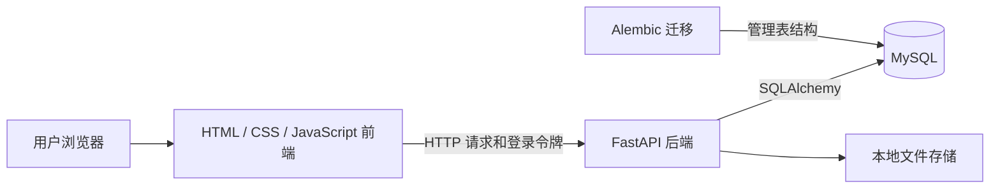
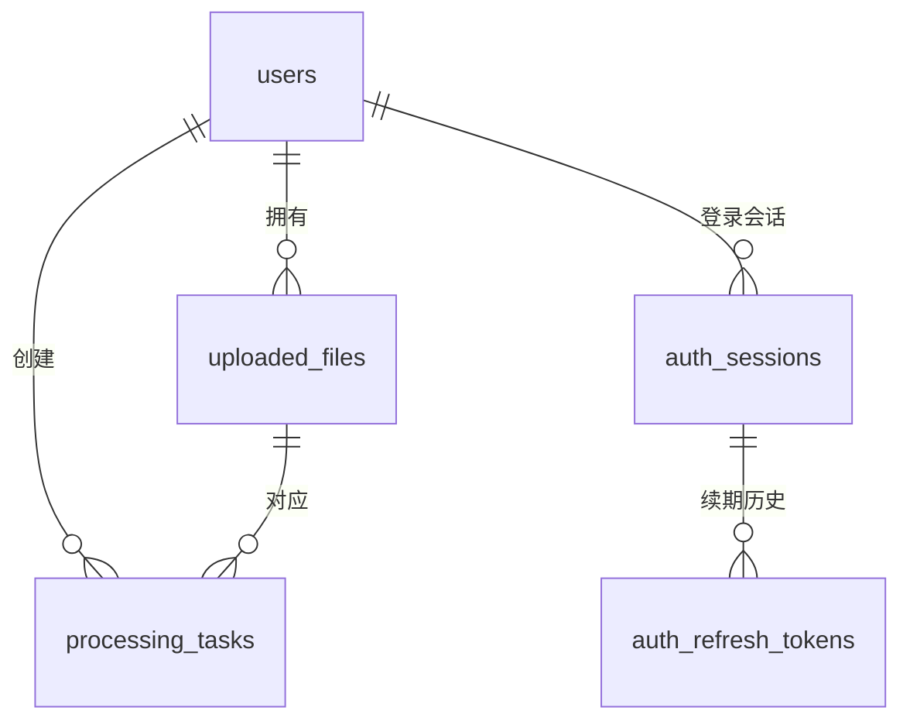
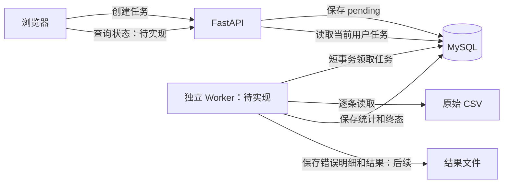

# 行序 · 数据处理平台：整体架构与开发路线

更新日期：2026-10-28。

这份文档用于把项目目标、当前代码和后续工作放到一张地图里。阅读顺序是：先看第 1～3 节理解全貌，再看第 8 节确定下一阶段；具体代码需要时再查第 6 节。

文中的“已实现”来自当前仓库代码；“建议方案”和“待实现”表示后续设计，不代表程序现在已经具备这些能力。本次整理文档不启动后台任务，也不改变数据库或处理已有数据。

## 1. 先记住这五件事

1. **项目目标**：用户上传 CSV，系统在后台按明确规则检查数据，给出统计和错误明细。
2. **当前进度**：注册登录、上传保存、预览、表头确认、创建任务记录，已经接通前后端。
3. **当前停止的位置**：任务保存为 `pending`，还没有后台进程执行它。
4. **下一阶段**：跑通“后台领取 → 读取 CSV → 保存执行结果 → 更新状态 → 页面能查到”的最小闭环。
5. **后面的重点**：分批处理、幂等、故障恢复和性能验证；任务查询只是观察这些行为的入口。

```text
注册登录 → 上传 CSV → 预览 → 确认表头 → 创建任务
────────────────── 已接通前后端 ──────────────────
                                           ↓
                                    pending：任务记录
                                           ↓
                                    你现在在这里
                                           ↓
              后台领取 → 执行处理 → 保存结果 → 查看与下载
              ─────────────── 待实现 ───────────────
```

## 2. 项目究竟解决什么问题

业务人员拿到一批 CSV 数据，希望知道哪些记录能用、哪些有问题，以及具体原因。文件较大时，不希望一直等待一个 HTTP 请求；处理中断时，希望能找到任务、识别失败，并逐步做到重试或恢复。

一份订单 CSV 可以作为演示数据，例如检查缺失字段、重复订单号、错误金额和无效日期。订单是应用场景示例，当前代码支持通用列结构，没有订单业务表，也没有把有效订单导入业务系统的实现。

### 第一版的业务终点

```text
上传文件
→ 确认列结构和本次检查规则
→ 提交后台任务
→ 查看状态和统计
→ 下载检查结果、有效数据和错误明细
```

建议先用“每条记录的列数是否与确认的列结构一致”跑通第一个检查场景，再增加必填、数字、日期和文件内重复检查。规则必须明确，不能要求系统凭列名自动猜出数据是否符合业务要求。

下一阶段暂时只统计数据记录数，用于证明后台执行链路能工作。**统计行数是技术验证，完成数据校验和错误输出后，才形成上述业务闭环。**

### 之后可以扩展的方向

字段映射与导入模板、数据清洗、业务入库、批次对比、多来源接入和定时执行，都属于后续扩展，不是当前后台执行阶段的前置条件。

## 3. 当前系统由什么组成



| 组件 | 当前职责 | 实现情况 |
| --- | --- | --- |
| 浏览器前端 | 登录、上传、预览、表头选择、创建任务与提示 | 已接入上述真实接口；任务和文件列表仍是示例 |
| FastAPI + Pydantic | 接收请求、验证参数、检查身份和归属、调用业务方法 | 已实现当前范围 |
| SQLAlchemy + MySQL | 保存账号、会话、文件信息、表头配置和任务记录 | 已实现当前范围 |
| Alembic | 管理数据库结构变更 | 已有 0001～0005 迁移 |
| 本地文件存储 | 保存原始 CSV 字节，数据库保存相对存储位置 | 已实现 |
| 独立 Worker | 在请求返回后继续执行文件处理 | 尚未实现 |

当前没有运行中的 Redis、Celery 或其他消息队列。现有文件上传接口仍在 HTTP 请求中完成完整 CSV 语法检查，因此上传检查本身还不是异步任务。

## 4. 文件、任务和执行，分别是什么

| 概念 | 回答的问题 | 存在哪里 |
| --- | --- | --- |
| 原文件 | 用户上传了哪些原始字节？ | 本地存储目录 |
| 文件信息 | 文件叫什么、多大、属于谁、存在哪里、表头是什么？ | `uploaded_files` |
| 任务记录 | 哪个用户要对哪个文件执行一次处理，现在是什么状态？ | `processing_tasks` |
| 后台执行 | 哪个进程实际读取文件、计算结果、更新任务？ | 将来的 Worker 程序；结果需要持久化 |

**创建任务就是保存一次处理请求；执行任务才是真正处理数据。** 当前只完成了前者。

一个用户可以上传多个文件，一个文件可以对应多次独立处理，所以不要给 `processing_tasks.file_id` 加唯一约束来限制同文件只能有一个任务。

### 当前数据库关系



| 表 | 当前保存的核心内容 |
| --- | --- |
| `users` | 用户账号、密码哈希、角色、启用状态 |
| `auth_sessions` | 登录会话、到期时间、撤销状态 |
| `auth_refresh_tokens` | 续期凭据摘要、轮换与请求历史 |
| `uploaded_files` | 文件编号、owner_id、原名、storage_key、大小、时间、has_header、columns |
| `processing_tasks` | id、file_id、owner_id、status、created_at、updated_at |
| `alembic_version` | 当前数据库迁移版本 |

任务表当前**没有**配置快照、进度计数、执行结果、错误原因、心跳或检查点字段。不能仅凭有了任务表，就认为这些功能也已经存在。

两个外键只能保证关联文件和用户存在；“任务用户必须也是文件所属用户”由当前创建任务业务方法检查。

## 5. 用户现在的一次操作，经过哪些步骤

| 步骤 | 前端做什么 | 后端做什么 | 保存结果 |
| --- | --- | --- | --- |
| 1. 登录 | 提交账号和密码，保存当前标签页凭据 | 验证密码，建立会话，签发令牌 | MySQL 登录会话 |
| 2. 上传 | 用 multipart 提交一个 CSV | 验证身份、文件大小、编码、CSV 语法；保存文件 | 原始 CSV + 文件记录 |
| 3. 预览 | 显示前 5 条原始记录 | 上传响应提供有界预览 | 原文件完整保留 |
| 4. 确认表头 | 选择有无表头，点击确认 | 检查文件归属，从原文件读取完整列结构并保存 | 文件表的 has_header、columns |
| 5. 创建任务 | 单独点击“创建任务” | 检查文件归属，生成编号，提交 pending 记录 | 任务表新增一条记录 |
| 6. 显示成功 | 展示真实任务编号与 pending | 已完成任务记录提交 | 当前弹窗展示结果 |

目前流程到第 6 步结束，文件不会继续被后台处理。

需要区分三个细节：

- 上传文件和创建任务是两个接口、两次明确操作；上传成功不会自动创建任务。
- 前端要求先成功保存表头设置才启用创建按钮；后端创建接口目前只检查文件归属，尚不强制表头已经确认。
- 前端成功后会阻止当前弹窗再次点击，但后端还没有请求去重；网络响应丢失后再次提交，仍可能创建另一条任务。

刷新页面后，弹窗里的预览和任务提示不会自动恢复；数据库记录仍在。页面上的任务列表目前是示例，不能用它判断刚创建的真实任务有没有保存。

## 6. 代码应该去哪里找

### 按调用过程找

```text
frontend/file-upload.js
    ↓ POST /api/tasks
backend/app/api/tasks.py
    ↓ get_current_user + get_database_session
backend/app/application/create_processing_task.py
    ↓ 检查文件归属，add，commit
backend/app/infrastructure/db/models/processing_task.py
    ↓
MySQL.processing_tasks
```

| 位置 | 职责 |
| --- | --- |
| `frontend/index.html`、`styles.css` | 页面结构和样式 |
| `frontend/file-upload.js` | 上传、预览、表头确认、任务创建及状态提示 |
| `frontend/auth-session.js` | 标签页登录凭据、自动续期及会话变化处理 |
| `frontend/app.js`、`demo-data.js` | 工作台展示交互和静态示例 |
| `backend/app/main.py` | FastAPI 应用入口、资源生命周期、路由注册 |
| `backend/app/api/` | 请求参数、认证依赖、HTTP 响应与异常转换 |
| `backend/app/application/` | 组织业务步骤，决定事务提交 |
| `backend/app/domain/` | 已有用户、文件等业务对象与规则 |
| `backend/app/infrastructure/db/` | 数据库引擎、Session、ORM 模型 |
| `backend/app/infrastructure/files/` | 文件保存、编码与 CSV 解析 |
| `backend/migrations/` | 数据库结构迁移 |
| `backend/tests/`、`frontend/tests/` | 后端、MySQL 和前端行为验证 |

账号、文件模块已有仓库接口和 UnitOfWork；**当前任务创建采用更直接的方式：应用方法使用 SQLAlchemy Session 和 ORM 模型。** 不要把目录分层理解为每个新功能都必须重新增加一套领域对象、仓库和事务封装。以后出现复用或复杂业务规则时，再有依据地调整。

### 当前与文件、任务相关的接口

| 接口 | 当前能力 |
| --- | --- |
| `POST /api/files` | 保存文件，返回文件编号和预览 |
| `PUT /api/files/{file_id}/header` | 保存当前用户文件的表头设置 |
| `POST /api/tasks` | 创建当前用户的 pending 任务记录 |
| `GET /api/tasks/{task_id}` | **尚未实现**，将作为执行状态和结果的观察入口 |

创建任务接口成功返回 `201`；未认证 `401`；文件不存在或归属不符 `404`；参数不符 `422`。普通内部异常使用现有通用 `500` 响应。

## 7. 后台执行的目标架构

本节是**建议的下一阶段方案**，不是当前实现。

初版建议使用“独立 Worker + MySQL 任务表轮询”，先复用已有数据库完成执行闭环。Celery、Redis 等组件暂不作为这个阶段的前置条件；后续有明确调度、部署或容量需求时，再评估消息队列。



API 进程负责快速接收请求；Worker 进程负责较长时间的数据处理。两者使用同一份任务记录和可访问的文件存储。若以后分机器部署，需确保 Worker 也能读取原文件，不能假设另一台机器能读取 API 机器的本地路径。

### Worker 一次工作的顺序

```text
短事务：找到一条可执行的 pending 任务，锁定并改为 running，提交
    ↓
事务之外：读取 CSV，执行当前阶段的处理
    ↓
短事务：保存统计、结果位置或失败原因，更新终态，提交
```

并发领取建议使用 MySQL 的行锁与 `SKIP LOCKED`，让不同 Worker 领取不同任务；领取成功后立即释放锁，不持有行锁处理整份文件。没有任务时等待一小段时间再检查，避免空转。

`running` 表示“已经被领取”，**不等于进程此刻一定还活着**。第一轮 Worker 被强制结束后，任务可能停在 running；心跳和超时恢复属于后续可靠性阶段，不能提前宣称已解决。

### 处理结果怎样理解

| 情况 | 应有结果 |
| --- | --- |
| 完成检查，全部记录有效 | succeeded，给出统计 |
| 完成检查，部分记录有业务错误 | succeeded，同时给出无效记录数和错误明细 |
| 文件无法读取、处理程序异常等导致检查未完成 | failed，保存可供定位的原因 |

数据记录数不一定等于物理文本行数，因为 CSV 字段可以包含换行。有表头时，应明确统计是否排除第一条 CSV 记录。

## 8. 接下来按什么顺序做

### 阶段 A：接收文件与创建任务——当前已完成的主流程

交付：用户登录、上传保存、预览、表头确认、前后端任务创建。

边界：真实文件与任务列表、任务查询、后台执行仍未实现。基础流程完成不代表所有辅助管理功能也已完成。

### 阶段 B：后台执行最小闭环——下一阶段

**目标：提交任务后，由独立进程读取真实 CSV、统计数据记录数、保存结果，页面可以查询执行状态。**

这一阶段开始前，集中补齐下面几个依赖，不另开一套庞大的管理功能：

| 依赖 | 为什么需要 | 当前情况 |
| --- | --- | --- |
| 确定并固定本次输入配置 | 用户以后修改文件表头，不应改变已创建任务的处理含义 | 任务当前没有表头/列配置快照；建议扩展任务字段并在创建时保存 |
| 定义可执行条件 | 绕过前端也可能创建未确认表头的任务 | 后端需要检查；已有 pending 记录也要明确处理策略，不能直接假定设置完整 |
| 待处理任务索引 | Worker 按状态和时间找任务 | 当前只有文件、用户索引；建议增加状态和时间联合索引 |
| 最小执行结果存储 | 完成后需要留下记录数，异常时需要留下原因 | 当前任务表没有这些字段；本阶段按需要增加 |

建议实施顺序：

1. 明确输入配置和统计口径，集中修改模型、迁移及创建逻辑。
2. 实现独立 Worker 的启动、领取和状态更新。
3. 逐条读取 CSV，先只统计记录数；读取过程不把整个文件加载成列表。
4. 增加单任务查询接口，并让前端能查看本次任务的真实状态和统计。
5. 验证成功、读取失败和两个 Worker 并发领取的情况。

完成标志：提交后请求已经返回，Worker 仍独立工作；任务能从 pending 变为 running、succeeded 或 failed；处理结果可查询。同一条待处理任务不会被两个 Worker 同时领取。

**本阶段不单独开发完整任务管理系统，不加入规则模板编辑器、业务订单入库、多数据源或定时调度。**

### 阶段 C：完成第一个有业务价值的数据处理闭环

目标：从“读过文件、统计了数量”升级为“找出错误，并能交付结果”。

先实现列数一致性检查；保存数据记录序号、错误类型和原因；输出统计、有效数据和错误明细。随后逐项增加必填、数字、日期、文件内唯一等规则，规则配置跟随任务保存。

处理按批进行，错误明细和统计也按批持久化，避免全部积累在内存中。有效记录数、无效记录数和错误数量分别统计，一条记录可以有多个错误。

完成标志：一份包含已知错误的测试 CSV，处理结果与预期一致；用户能定位问题记录并下载结果；含错误数据的正常检查任务仍能成功完成。

### 阶段 D：可靠性与性能——项目的技术重点

| 能力 | 要解决的问题 | 验证方式 |
| --- | --- | --- |
| 创建请求去重 | 网络重试导致创建多个任务 | 同一次请求重发，返回同一任务 |
| 执行幂等 | 同一任务重新执行，结果被重复写入 | 重复执行后核对统计和结果唯一性 |
| 批次与检查点 | 中断后无法判断已经完成多少 | 批次结果与进度在同一事务里提交 |
| 故障恢复 | Worker 退出后任务停留在 running | 心跳/执行期限识别中断，明确重试或恢复策略 |
| 并发与容量 | 上传和任务增长超过处理能力 | 设置并发上限，观察待处理数量、耗时和失败 |
| 性能分析 | 不清楚时间、内存和数据库开销花在哪里 | 在固定数据集上测量，再针对瓶颈优化 |

恢复不能简单地把所有 running 任务重置；需要确认执行是否仍然有效，避免旧进程和恢复进程同时写结果。

完成标志：处理途中主动停止 Worker，重启后按设计重试或恢复，结果不重复；从带 task_id 的日志中能够解释失败与恢复过程。

### 阶段 E：产品扩展——完成核心闭环后再选

导入模板、字段映射、清洗转换、业务入库、批次质量趋势、多来源和定时执行。一次选择一个具体场景扩展，不同时引入所有方向。

## 9. 为什么这些工作不只是增删改查

创建和查询任务是基础接口，作用是让用户提交工作、观察工作。项目的技术深度在于接口返回之后，系统仍然能正确处理大批量数据。

| 基础能力 | 技术重点 |
| --- | --- |
| 保存一条任务 | 多进程如何安全领取任务 |
| 查询任务状态 | 状态、批次结果、统计如何保持一致 |
| 点击重试 | 重复执行如何不产生重复结果 |
| 上传大文件 | 如何流式读取、分批提交并控制内存 |
| 显示失败 | 如何定位失败，识别中断并恢复 |

因此，查询接口应跟随执行闭环完成，不需要把它独立扩展成一大轮任务管理页面开发。

## 10. 以后每次开发，都按这四项说明

开始一个功能前，只先说清楚：

1. **属于哪个阶段**：例如阶段 B，后台执行最小闭环。
2. **本次要交付什么**：例如安全领取一条任务，而不是同时完成所有可靠性功能。
3. **依赖哪些现有或缺失能力**：需要补什么字段、索引或方法，一次列出。
4. **怎样证明完成**：给出能够实际执行、观察结果的验证场景。

发现前置条件时，先判断是不是当前闭环必需的最小依赖；例如需要读取文件配置，不等于必须先实现完整文件管理页面。

当前下一步固定为阶段 B。具体实现之前，以本节方式列出阶段 B 的改动范围和验收场景，避免在领域对象、任务查询、规则配置、消息队列之间来回切换。

---

配套说明：[项目运行与接口说明](../README.md) · [后端细节](../backend/README.md) · [前端交互与限制](../frontend/README.md)。
